<div align="center">

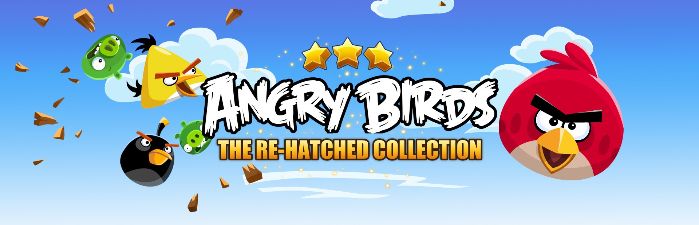

### Angry Birds Classic, Seasons, Rio and Star Wars on PC, running natively, in one launcher made for the couch.

[](https://github.com/TekRantGaming/angry-birds-re-hatched-collection/releases/latest)
&nbsp;
[](https://discord.gg/8eakYSvBZS)

[](https://github.com/TekRantGaming/angry-birds-re-hatched-collection/releases/latest)
[](https://github.com/TekRantGaming/angry-birds-re-hatched-collection/releases)


<br>

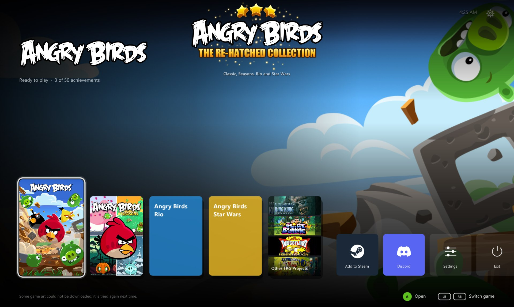

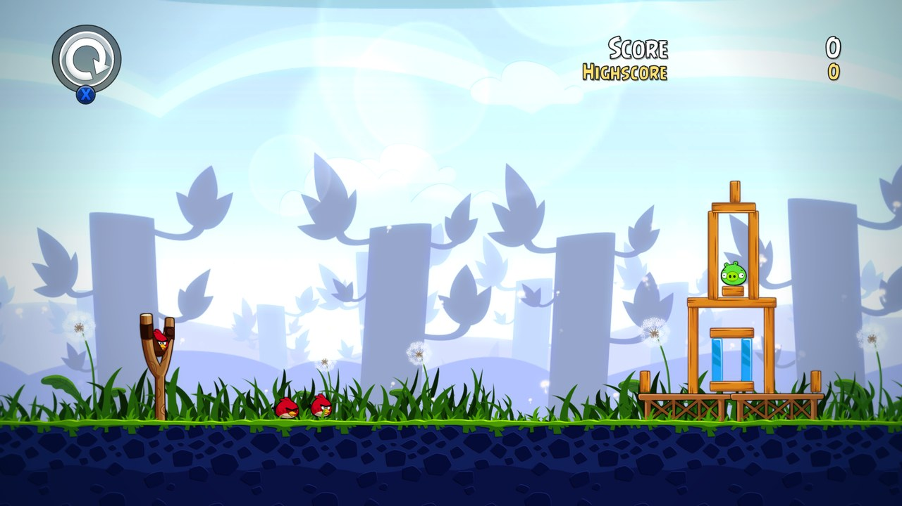
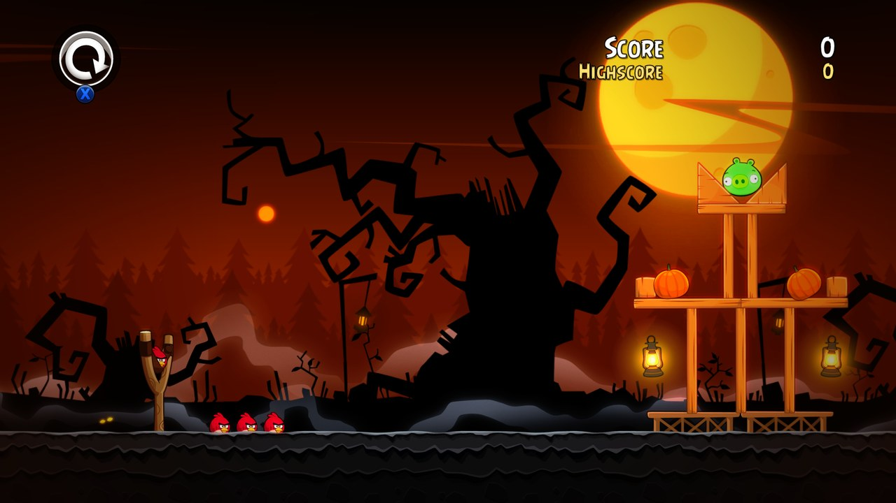
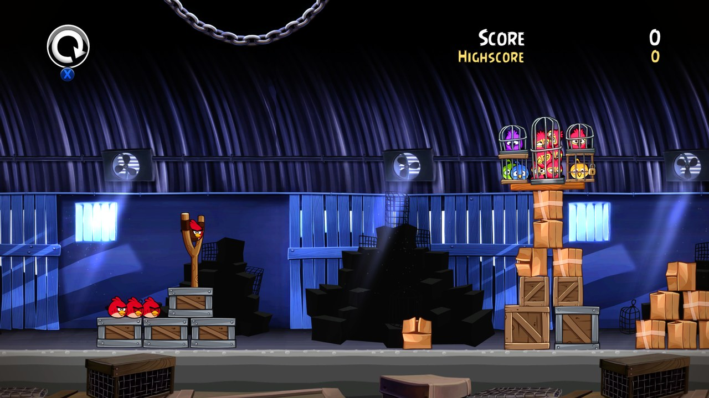
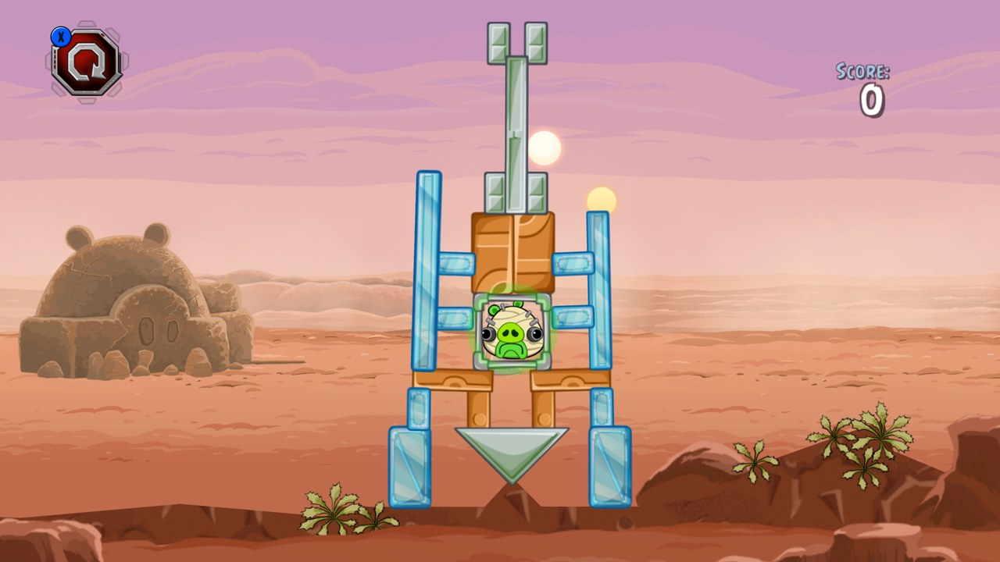

<sub>The original Xbox 360 game code, translated to native PC code with the <a href="https://github.com/rexglue/rexglue-sdk">ReXGlue SDK</a>. <b>No game files included</b>: bring your own copy of each Xbox 360 disc.</sub>

</div>

<br>

## At a glance

| | | |
| :--- | :--- | :--- |
| 🐦 **All 4 games** in one launcher, from 2 discs | 🖥️ **Up to 4K**, at 30, 60, 90, 120 or an **unlimited** frame rate | ✨ **AMD FSR 1 and NVIDIA NIS** upscaling |
| 🎮 **Any controller**, made for the couch | 🏆 **Achievements** with notifications in game, 50 per disc | ↩️ **Back to the launcher** any time: hold Back + Start, or Esc |
| 💿 **Install from your own discs**, found on your PC by themselves | 🔄 **Updates itself** and every game | 💾 **Save backups** and restore in one click |
| 🛋️ **A console style dashboard** with sounds, made for a controller | 🪟 **Borderless fullscreen**, windowed, any monitor | 🦍 **Other TRG Projects**, with King Kong Recompiled ready to install |
| 🚂 **Add to Steam** with its own artwork, ready for Big Picture | ⏩ **Straight into the game**: logos and intro movies skipped, each Trilogy game starts on its own | 💬 **[Join the Discord](https://discord.gg/8eakYSvBZS)** right from Home |

<div align="center">

## The trailer

<i>Coming soon.</i>

</div>

## The games

<div align="center">

### Angry Birds Classic


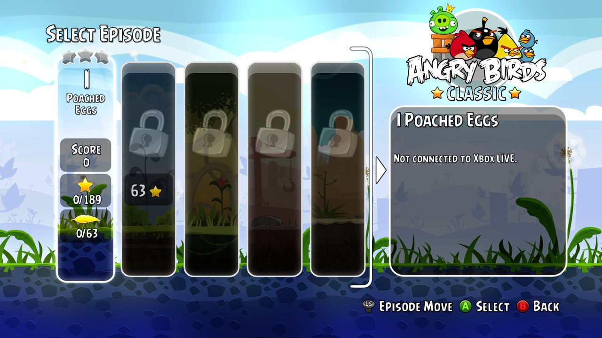
<sub><b>Where it all began.</b> The pigs stole the eggs. Pull back the slingshot and bring the whole thing down, from Poached Eggs on.</sub>

<br><br>

### Angry Birds Seasons


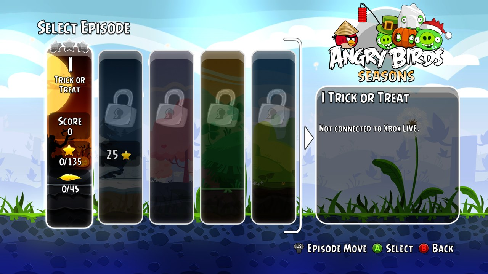
<sub><b>A year of holidays.</b> Halloween, Christmas, Valentine's Day and more, starting with Trick or Treat.</sub>

<br><br>

### Angry Birds Rio


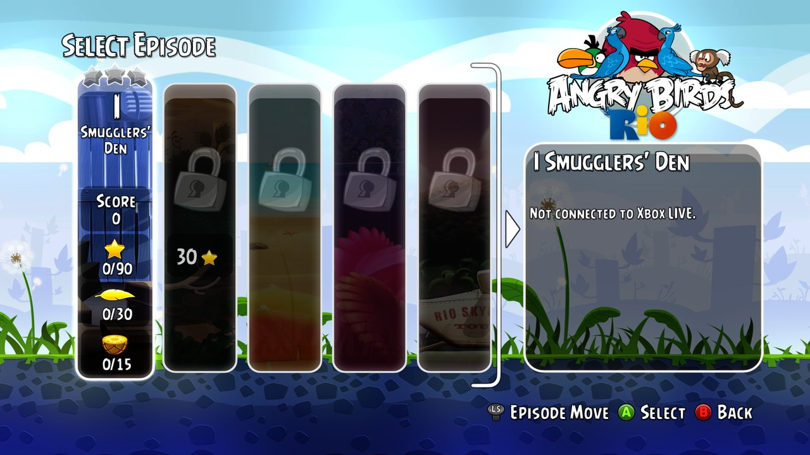
<sub><b>Free the caged birds.</b> Smugglers took the birds to Rio de Janeiro. Break them out, from Smugglers' Den on.</sub>

<br><br>

### Angry Birds Star Wars


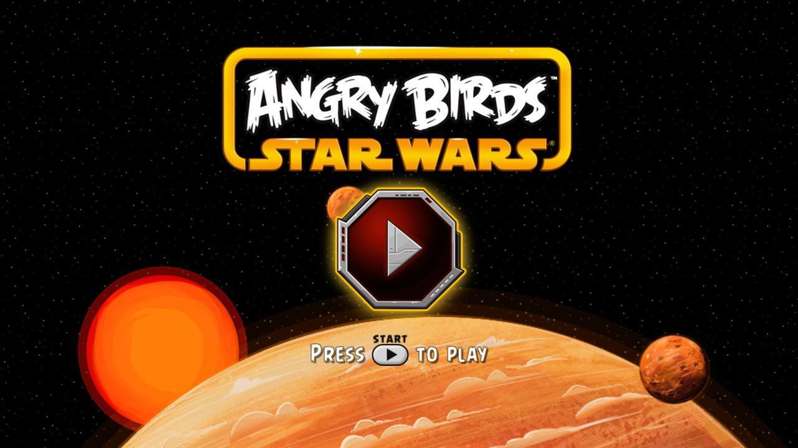
<sub><b>A long time ago, in a galaxy of pigs.</b> Lightsabers, blasters and the Force, from Tatooine to the Death Star.</sub>

</div>

<br>

## Getting started

**You need:** Windows 10 or 11 (64 bit) with a DirectX 12 graphics card, a controller, and a disc image you made from your own disc for each game you want to play (see [Which discs you need](#which-discs-you-need)).

1. Download **AngryBirdsCollection-...-windows-x64.zip** from the [latest release](https://github.com/TekRantGaming/angry-birds-re-hatched-collection/releases/latest) and unzip it anywhere. It holds the launcher and both programs, and everything stays in that folder, so it's portable.
2. Run **angry_birds_launcher.exe**. It opens in fullscreen on Home. Windows may warn about an unknown publisher the first time: choose **More info**, then **Run anyway**.
3. Pick a game and press **Play**. The first time, the launcher asks for your disc image of that game: it finds disc images on your PC by itself (or choose the file), checks the disc and copies the game files next to the game. One Angry Birds Trilogy disc installs Classic, Seasons and Rio together.
4. Press **Play** again, and from then on it starts straight away, skipping the logos, right on the game you picked.

While you play, **hold Back and Start** on the controller, or **hold Esc**, to come back to the launcher. **No game files are included**: they come from your own discs. Your saves are kept in `Documents\ab_trilogy` (Classic, Seasons and Rio) and `Documents\ab_starwars`.

### Which discs you need

Only the title ID is checked, so any good dump of these discs works. These are the images the ports were made and tested with:

| Game | Title ID | Media ID | Version | Disc image | SHA1 | Installed |
| --- | --- | --- | --- | --- | --- | --- |
| Angry Birds Trilogy (Classic, Seasons, Rio) | `415608E4` | `1A15DA04` | `0.0.0.2` | 7,838,695,424 bytes | `AA9F23082753DCF7FA7A43C1E336BA0FB898F03B` | about 1.3 GB |
| Angry Birds Star Wars | `41560901` | `116000C4` | `0.0.0.2` | 7,838,695,424 bytes | `076C847F6CCE7BB536D42937C05CB5EA2D02123A` | about 1.3 GB |

The launcher's install screen shows every detail for each disc, MD5 and CRC32 too. To check a disc image yourself, run this in PowerShell and compare the result with the SHA1 above:

```powershell
Get-FileHash "C:\Games\Angry Birds Trilogy (USA, Europe) (En,Fr,De,Es,It).iso" -Algorithm SHA1
```

## The launcher

Everything is set up before a game starts, with a controller. Each game has its own page and its own settings.

<table>
<tr>
<td width="55%"></td>
<td valign="middle">

### Home
- **All four games** side by side, with their box art and artwork
- Each game shows at a glance whether it's **ready to play**, its version and your **achievements**
- **Settings** for the launcher, and **Other TRG Projects**
- **Add to Steam**: adds the collection to your Steam library as a non Steam game, with its own artwork (cover, banner, header, logo and icon), and switches Steam Input off for it so your controller keeps working. Steam closes for a moment while it's added and opens again afterwards; once it's in your library the button opens Steam instead
- **Discord**: joins the official server
- Plays with a **controller**, with interface sounds

</td>
</tr>
<tr>
<td valign="middle">

### Game page
- **Play**, the only place a game starts
- **Settings** and **Saves and install** for that game
- Your **achievements** so far, your **save backups** and the **release notes** of its latest version

</td>
<td width="55%">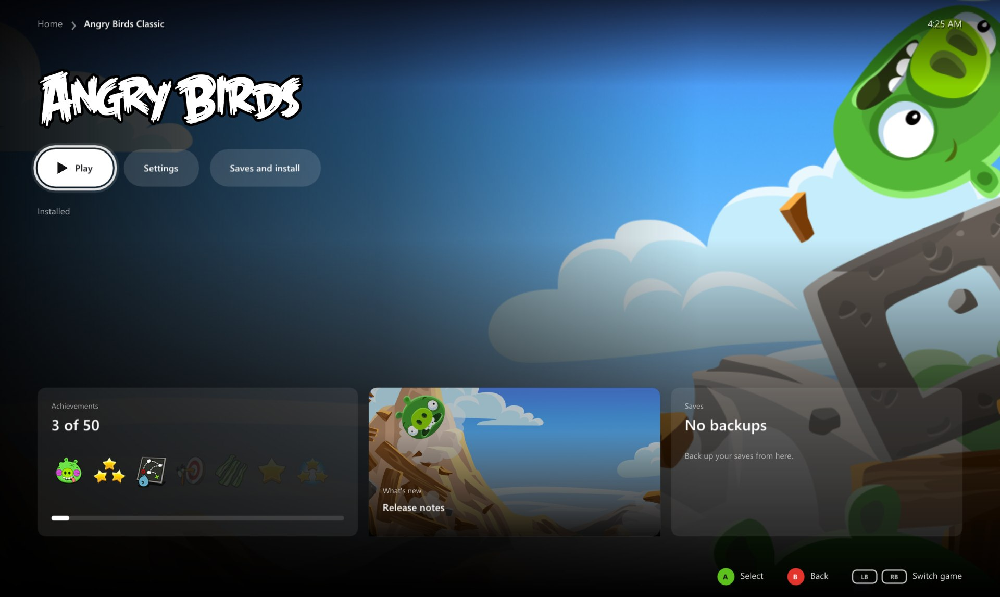</td>
</tr>
<tr>
<td>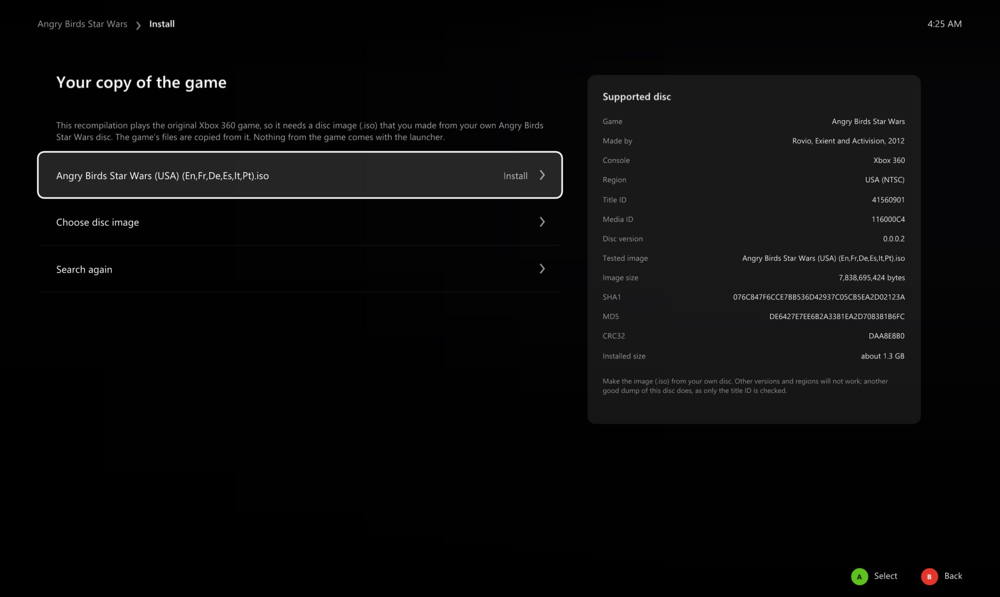</td>
<td valign="middle">

### Install from your own disc
- The launcher **finds disc images** on your PC by itself, or you **choose the file**
- A card shows **exactly which disc works**: title ID, media ID, version, size, SHA1, MD5 and CRC32
- It checks the disc really is that game, then copies the files with a progress bar

</td>
</tr>
<tr>
<td valign="middle">

### Display
- **Fullscreen** or **windowed**, **choose the monitor**, vertical sync
- **Resolution**: 720p, 1080p, 1440p, 4K or your screen. The game is drawn at that size, and a window opens at it
- **Frame rate**, for each game on its own: 30, **60** (the default), 90, 120 or **no limit**. The game still runs at the right speed
- **Keep the original shape** with black bars, or stretch to fill

</td>
<td width="55%">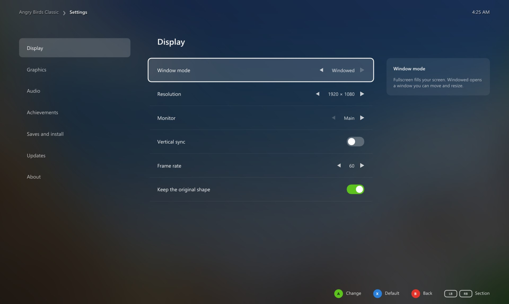</td>
</tr>
<tr>
<td>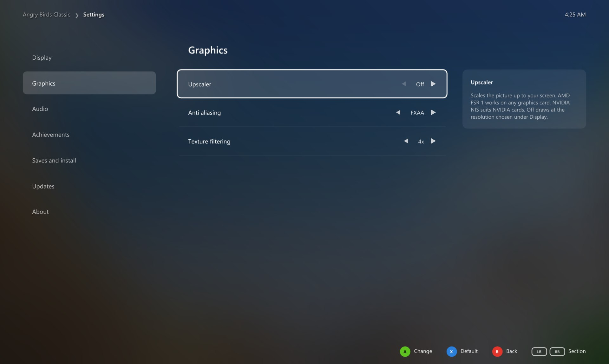</td>
<td valign="middle">

### Graphics
- **Upscaler**: AMD FSR 1 or NVIDIA NIS, with Native, Quality, Balanced and Performance modes, worked out from the resolution you chose
- **FXAA** and **texture filtering** up to 16x

</td>
</tr>
<tr>
<td valign="middle">

### Achievements
- All **50 achievements** of each disc, with their pictures and gamerscore
- **Notifications in game** when you unlock one, with their sound on or off and its volume
- A **test button** to see and hear it

</td>
<td width="55%">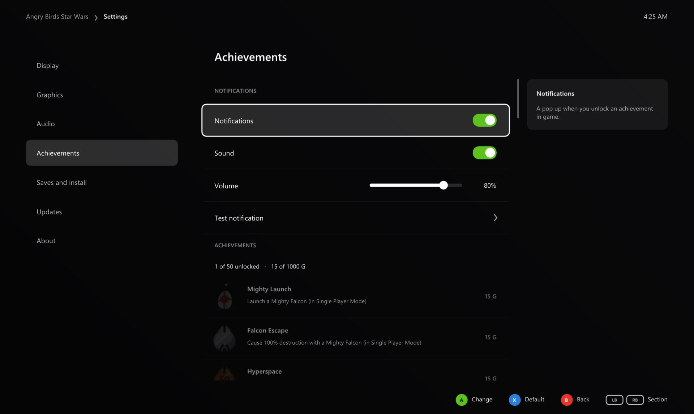</td>
</tr>
<tr>
<td>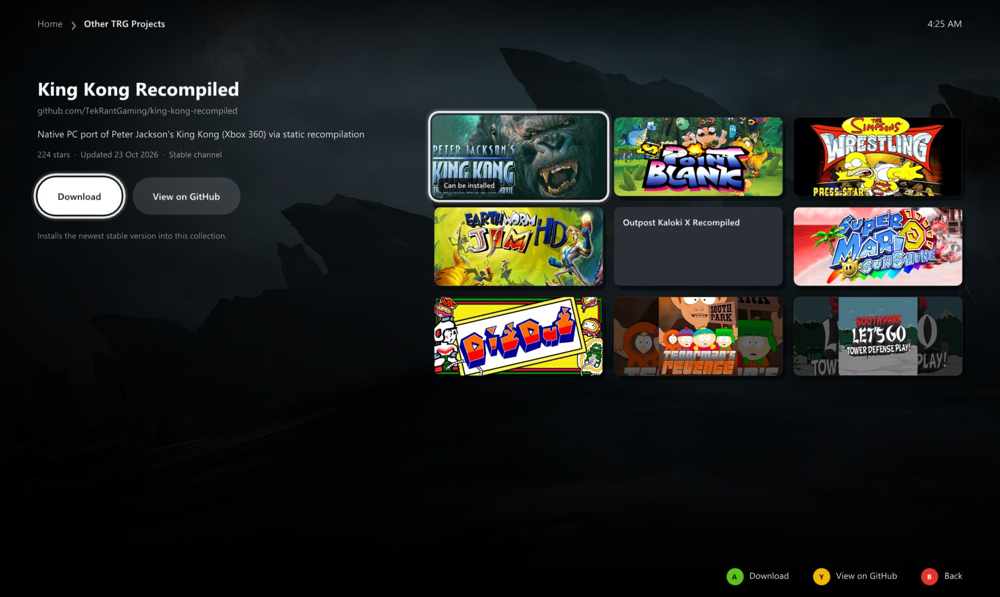</td>
<td valign="middle">

### Other TRG Projects
- The other **TekRantGaming** ports, with their artwork and a link to each
- **King Kong Recompiled** downloads and plays right from here

</td>
</tr>
</table>

### Saves and updates

Each game's **Saves and install** page backs up your saves and restores them, opens the save, backup and game folders, reinstalls from your disc or removes the game. When the launcher opens it checks GitHub for new versions of itself and of each game and **installs them by themselves**, restarting into a new launcher once nothing else is going on; your games, saves and settings stay as they are. Turn that off in the launcher's own **Settings**.

## Xbox 360 vs PC

| | Xbox 360 | PC |
| --- | :---: | :---: |
| Resolution | 1280 x 720 | 720p, 1080p, 1440p or 4K |
| Frame rate | 60 fps | 30, 60, 90, 120 or no limit, for each game |
| Upscaling | none | AMD FSR 1 or NVIDIA NIS, four modes each |
| Anti aliasing | console | FXAA, or higher resolutions |
| Texture filtering | console | up to 16x |
| Display | TV | borderless fullscreen or windowed, any monitor |
| Startup | logos, intro movies, a menu to pick the game | straight into the game you picked |
| Achievements | console | notifications in game, with sound |
| Four games | two discs | one launcher |

## Good to know

### Hotkeys

| Key | Action |
| --- | --- |
| Hold <kbd>Back</kbd> + <kbd>Start</kbd>, or hold <kbd>Esc</kbd> | back to the launcher while playing |
| <kbd>F11</kbd> | the launcher fullscreen or windowed |

### Multiplayer in Star Wars

The Star Wars disc this port was made from has no multiplayer content, so its Multiplayer button does nothing.

### Reporting a problem

Please open an [issue](https://github.com/TekRantGaming/angry-birds-re-hatched-collection/issues) with the game, what happened, your CPU, graphics card and the resolution and frame rate you play at, or ask on the [Discord](https://discord.gg/8eakYSvBZS).

## About the games

*Angry Birds Trilogy* brought *Angry Birds*, *Angry Birds Seasons* and *Angry Birds Rio* to consoles in 2012, rebuilt for the TV with new levels. *Angry Birds Star Wars* followed in 2013. Both games were made with Rovio Entertainment and published by Activision; Trilogy was developed by Housemarque and Star Wars by Exient.

Until now the only way to play these console versions was on a console. This collection runs all four games natively on Windows, starts each one on its own, and adds the options you would expect from a PC release.

<details>
<summary><b>Building from source (for developers)</b></summary>

See [BUILDING.md](BUILDING.md). The game code is generated from each disc's own `default.xex`, so building a game needs your own disc too.

</details>

## Credits

- **Angry Birds Trilogy** (Classic, Seasons and Rio) by Rovio Entertainment and Housemarque, and **Angry Birds Star Wars** by Rovio Entertainment and Exient, both published by Activision.
- [**ReXGlue SDK**](https://github.com/rexglue/rexglue-sdk), which does the code translation and runs the games, built on the work of [**Xenia**](https://github.com/xenia-project/xenia) and [**XenonRecomp**](https://github.com/hedge-dev/XenonRecomp).
- [**Dear ImGui**](https://github.com/ocornut/imgui), [**SDL**](https://www.libsdl.org) and [**stb**](https://github.com/nothings/stb) for the launcher.
- The [**TRG Launcher**](https://github.com/TekRantGaming/trg-launcher) (dashboard, updater and settings), shared by the TekRantGaming ports.
- Game artwork in the launcher from [**SteamGridDB**](https://www.steamgriddb.com), downloaded when the launcher runs. The Add to Steam artwork is made from Angry Birds Trilogy's artwork on SteamGridDB.
- The Discord and Steam marks from [**Simple Icons**](https://simpleicons.org) (CC0). Discord and Steam are trademarks of their owners.
- Upscaling: [**AMD FidelityFX Super Resolution 1**](https://github.com/GPUOpen-Effects/FidelityFX-FSR) and the [**NVIDIA Image Scaling SDK**](https://github.com/NVIDIAGameWorks/NVIDIAImageScaling), both MIT licensed.

> [!NOTE]
> **AI disclosure:** this collection was made almost entirely with Claude Code (Anthropic). The repository owner directed and tested the work; the AI did the analysis, code, tools and documentation.

> [!IMPORTANT]
> This project is not affiliated with or endorsed by Rovio Entertainment, Activision, Housemarque, Exient, Lucasfilm, Microsoft, Valve or Discord. All trademarks belong to their owners. It contains no game code or assets. Do not open issues asking for game files.
